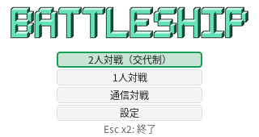
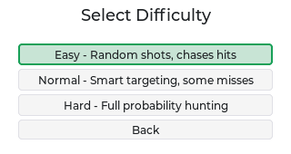
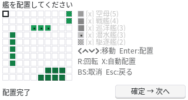
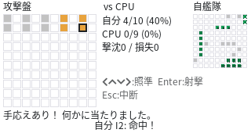
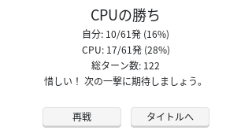
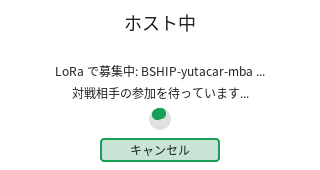

# Battleship for CardputerZero

[M5Stack CardputerZero](https://cardputerzero.github.io/)（320×170、LVGL v9.5 + C++/CMake）向けに作られた、古典的な海戦ゲームです。

- **1人用**: ローカル（オンデバイス）の確率密度 AI と対戦（クラウド・LLM 不使用）。難易度3段階、戦況を実況する定型文コメント機能（設定でON/OFF切替可能）。
- **2人用**: もう1台の CardputerZero と **BLE**（デフォルト、アクセスポイント不要）、オプションで **LoRa**（Cap LoRa-1262 使用）、または1台での交互プレイ（**ホットシート**）で対戦。
- **対応言語**: English / 日本語 / 简体中文 — 設定画面からいつでも切り替え可能（再起動不要）。

English README is available at [README.md](README.md).

## スクリーンショット

| メニュー | 難易度選択 | 配置画面 |
| --- | --- | --- |
|  |  |  |

| 戦闘中 | リザルト | LoRa 対戦 |
| --- | --- | --- |
|  |  |  |

日本語・簡体字中国語 UI を含む追加のスクリーンショットは [`docs/screenshots/`](docs/screenshots/)（`i18n_ja_*` / `i18n_zh_*` ファイル）にあります。

## 遊び方

古典的なバトルシップのルールです。各プレイヤーは10×10マスの盤に5隻の艦隊（空母5・戦艦4・巡洋艦3・潜水艦3・駆逐艦2）を、縦横一直線・重ならないように秘密裏に配置します。その後、交互に相手の盤の1マスを指定して攻撃し、命中は記録され、撃沈した艦種が通知されます。相手の艦隊を全て撃沈した方が勝利です。

### キー操作

| キー | 動作 |
| --- | --- |
| 矢印キー | カーソル移動・フォーカス移動 |
| Enter | 決定 — 艦の配置、選択マスへの攻撃、ハンドオーバー/準備完了の確定 |
| `R` | 艦の向きを回転（配置画面） |
| `X` | 現在のプレイヤーの艦隊をランダム配置（配置画面） |
| Backspace | 直前に置いた艦を取り消す（配置画面） |
| Esc（短押し） | 1階層戻る／表示中のダイアログを閉じる（対戦中は中断確認モーダルを表示） |
| Esc（長押し、約1秒）または Home | どの画面からでも安全に終了（通信対戦中も相手側へ通知した上で終了） |

## インストール

**CardputerZero Hub AppStore から（推奨）**: Hub アプリで「Battleship」を検索し、そのままインストールできます。

**手動インストール**（`.deb` を別途ビルド・入手した場合）:

```shell
sudo dpkg -i battleship_1.1.0-1_arm64.deb
# 依存パッケージの解決も同時に行いたい場合:
sudo apt install --no-install-recommends ./battleship_1.1.0-1_arm64.deb
```

インストール後、APPLaunch にアプリが表示されます。

### 実機でプレイする際の注意

- **BLE（デフォルトの2人用モード）** を使うには、端末の Bluetooth スタック（BlueZ）が起動していること、およびアプリを実行するユーザーが `bluetooth` グループに属していることが必要です（`sudo usermod -aG bluetooth <user>` 実行後に再ログイン）。設定が無い場合、アプリはクラッシュせず「Bluetooth unavailable」と表示されます。スキャンしても相手が見つからない場合は `rfkill unblock bluetooth` も確認してください。BLE 対戦は Wi-Fi をオフにすると最も安定します（Bluetooth と Wi-Fi は1本のアンテナを共用）。Wi-Fi 接続中はホスト／参加画面で警告を表示し、接続は自動的にリトライされます。BLE 対戦の画面を開いている間、アプリは Bluetooth のペアリング要求を自動的に受け入れ（ホスト時は近くの任意の端末から、参加時は選んだホストからのみ）、ペアリングは再接続を速くするため保持されます。
- **LoRa 2人用モード（任意）** には **Cap LoRa-1262**（SX1262）とアンテナが必要です。下記「LoRa 対戦」を参照してください。
- 本アプリは完全にオフラインで動作し、テレメトリや外部通信は一切行いません（LoRa UDP シミュレータはデスクトップ／`BATTLESHIP_LORA_SIM=1` のときのみ）。
- 戦況解説は固定の定型文システムです（ローカル LLM は使用・必要としません）。詳細は下記「[アーキテクチャ](#アーキテクチャ)」を参照してください。

### LoRa 対戦

Bluetooth の届かない距離で対戦できます。**Cap LoRa-1262** が必要です。

- Cap の着脱は**必ず本体の電源を切った状態**で行ってください（ホットスワップ不可）。
- **対戦前に必ずアンテナを接続**してください。アンテナ無しでの送信は禁止です。
- 無線設定（日本 920MHz 帯のルールに準拠）: 921.8 MHz、帯域幅 125 kHz、SF7、送信出力 13 dBm（20 mW）以下、送信前にリスニング（キャリアセンス 5 ms 以上、-90 dBm）。
- ホスト中は 2 秒ごとにビーコンを送信し、平文で "BATTLESHIP for CardputerZero - Store code BSHP" を含みます。
- 920MHz 帯 LoRa の使用が認められている地域でのみ使用してください。Cap が無い場合はエラー画面を表示します。

## 開発者向け情報

### ビルド方法（macOS デスクトップ）

Homebrew で依存関係をインストール:

```shell
brew install cmake ninja libpng jpeg fmt sdl2 freetype dpkg zlib
```

Configure・ビルド・テスト（Apple Silicon）:

```shell
cmake --preset darwin-arm64
cmake --build --preset darwin-arm64-dbg
ctest --preset darwin-arm64-dbg
```

デスクトップシミュレータの実行:

```shell
./build/darwin-arm64/Debug/battleship
```

Intel Mac の場合は `darwin-x86-64` の preset を使用してください。Linux デスクトップビルド、CardputerZero クロスビルド／実機向けデバイスビルド（Docker `debian:trixie` での手順を含む）、CMake オプション（`BATTLESHIP_BLE` / `BATTLESHIP_LLM` / `BATTLESHIP_WINDOW_ZOOM` 等）、フェーズごとの開発履歴の詳細は [`NOTES.md`](NOTES.md) を参照してください。

### アーキテクチャ

デスクトップ上で実機に触れる前にゲーム全体を開発・検証できるよう、ゲームロジック・通信・AI・UI を分離した構成になっています。

```
view/        LVGL v9 の画面・ウィジェット・艦種パターン描画・キー入力処理
i18n/        文字列カタログ（EN/JA/ZH）+ CJKフォント読み込み。LVGL・ゲームロジックに非依存
net/         トランスポート非依存プロトコル（フレーミング、ACK/再送）。BleTransport（BlueZ/D-Bus）と
             LoRaTransport（Cap LoRa-1262 / SX1262）を共通の ITransport インターフェースの背後に実装
core/        純粋な C++ ゲームロジック — 盤面・艦の配置検証・射撃判定・確率密度AI。
             I/O・LVGL・スレッドに非依存
commentary/  定型文による戦況解説（TemplateCommentator）。LLM 版の解説実装もツリー内に
             存在するが、既定 OFF のビルドフラグの下にあり現在は未使用
```

`core/` と `net/` は LVGL に依存せず、豊富な `ctest` スイート（ヘッドレス。AI同士の統計的対戦テストや2プロセスでの通信対戦シミュレーションを含む）でカバーされています。設計時の方針は [`PLAN.md`](PLAN.md)、実際に実装された内容や既知の制約は [`NOTES.md`](NOTES.md) を参照してください。

## ライセンス

本プロジェクトは [MIT License](LICENSE) のもとで公開されています。LVGL・フォント・fmt 等のサードパーティコンポーネントはそれぞれ独自のライセンスに従います — 一覧と `.deb` への同梱有無は [`THIRD_PARTY_LICENSES.md`](THIRD_PARTY_LICENSES.md) を参照してください。
