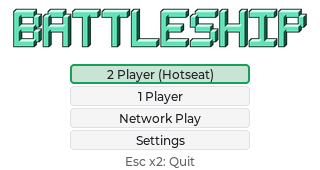
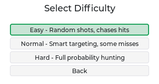
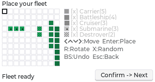
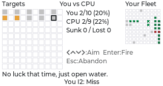
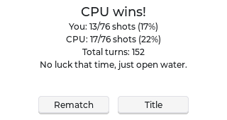
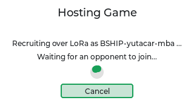

# Battleship for CardputerZero

A classic naval-combat game built for the [M5Stack CardputerZero](https://cardputerzero.github.io/) (320×170, LVGL v9.5 + C++/CMake).

- **1-player**: fight a local, on-device probability-density AI (no cloud, no LLM) across three difficulty levels, with live template battle commentary you can toggle off in Settings.
- **2-player**: play another CardputerZero over **BLE** (default, no access point needed) or, optionally, **LoRa** (with a Cap LoRa-1262), or pass-and-play **hotseat** on a single unit.
- **Languages**: English, 日本語 (Japanese), 简体中文 (Simplified Chinese) — switchable anytime from Settings, no restart required.

日本語版の README は [README.ja.md](README.ja.md) を参照してください。

## Screenshots

| Menu | Difficulty | Placement |
| --- | --- | --- |
|  |  |  |

| Battle | Result | LoRa play |
| --- | --- | --- |
|  |  |  |

More screenshots, including the Japanese and Simplified Chinese UI, are in [`docs/screenshots/`](docs/screenshots/) (see the `i18n_ja_*` and `i18n_zh_*` files).

## How to Play

Classic Battleship rules: each player secretly places a fleet of 5 ships (Carrier·5, Battleship·4, Cruiser·3, Submarine·3, Destroyer·2) on a 10×10 grid, ships placed in a straight line without overlapping. Players then take turns calling a cell on the opponent's grid; a hit is marked, a sunk ship is announced, and the first player to sink the entire enemy fleet wins.

### Key Controls

| Key | Action |
| --- | --- |
| Arrow keys | Move the cursor / change focus |
| Enter | Confirm — place a ship, fire at the selected cell, confirm handover/ready |
| `R` | Rotate ship orientation (Placement screen) |
| `X` | Randomize the current fleet's placement (Placement screen) |
| Backspace | Undo the last placed ship (Placement screen) |
| Esc (short press) | Go back one screen / dismiss the current dialog (asks for confirmation during an active Battle/Placement/Handover) |
| Esc (long press, ~1s) or Home | Quit the app safely from anywhere (any active network match is ended gracefully) |

## Installation

**From the CardputerZero Hub AppStore (recommended)**: search for "Battleship" in the Hub app and install it directly on your device.

**Manual install** (if you have a `.deb` built or downloaded separately):

```shell
sudo dpkg -i battleship_1.1.0-1_arm64.deb
# or, to also pull in any missing dependencies:
sudo apt install --no-install-recommends ./battleship_1.1.0-1_arm64.deb
```

The app appears in APPLaunch after installation.

### Notes for playing on real hardware

- **BLE (default 2-player mode)** requires the device's Bluetooth stack (BlueZ) to be running and the app's user account to be in the `bluetooth` group (`sudo usermod -aG bluetooth <user>`, then re-login). Without this, BLE features report "Bluetooth unavailable" instead of crashing. If a device doesn't show up when scanning, also check `rfkill unblock bluetooth`. BLE play works best with Wi-Fi turned off (the Bluetooth and Wi-Fi radios share one antenna), so the app warns on the host/join screens when Wi-Fi is connected; it also retries the connection automatically. While a BLE game is open the app accepts Bluetooth pairing requests automatically (when hosting: from any nearby device; when joining: only from the chosen host), and the pairing is kept for faster reconnects.
- **LoRa 2-player mode (optional)** requires a **Cap LoRa-1262** (SX1262) and an antenna. See [LoRa play](#lora-play) below.
- The game runs entirely offline; no telemetry or network calls are made. The only sockets in the tree are a LoRa UDP simulator used on desktop (or with `BATTLESHIP_LORA_SIM=1`), never in normal device use.
- Battle commentary is a fixed template-phrase system (no local LLM is used or required) — see [Architecture](#architecture) below.

### LoRa play

LoRa lets two CardputerZero units play beyond Bluetooth range. It needs a **Cap LoRa-1262**.

- Attach or detach the Cap **only while the unit is powered off** (no hot-swap).
- **Attach the antenna before playing.** Never transmit without it.
- Radio settings (Japan 920 MHz band rules): 921.8 MHz, 125 kHz bandwidth, SF7, transmit power at most 13 dBm (20 mW), and listen-before-talk (carrier sense of at least 5 ms at -90 dBm) before every transmission.
- While hosting, the app transmits a beacon every 2 s containing the plain text "BATTLESHIP for CardputerZero - Store code BSHP".
- Use LoRa play only where 920 MHz LoRa operation is permitted. Without the Cap attached, the app shows an error screen instead of crashing.

## Development

### Build (macOS desktop)

Install dependencies with Homebrew:

```shell
brew install cmake ninja libpng jpeg fmt sdl2 freetype dpkg zlib
```

Configure, build, and test (Apple Silicon):

```shell
cmake --preset darwin-arm64
cmake --build --preset darwin-arm64-dbg
ctest --preset darwin-arm64-dbg
```

Run the desktop simulator:

```shell
./build/darwin-arm64/Debug/battleship
```

For Intel Macs, use the `darwin-x86-64` presets instead. See [`NOTES.md`](NOTES.md) for Linux desktop builds, the CardputerZero cross-build/device build (including the Docker `debian:trixie` device-build runbook), CMake options (`BATTLESHIP_BLE`, `BATTLESHIP_LLM`, `BATTLESHIP_WINDOW_ZOOM`, etc.), and the full phase-by-phase development history.

### Architecture

The codebase separates game logic, networking, AI, and UI so the whole game can be developed and tested on desktop before ever touching real hardware:

```
view/        LVGL v9 screens, widgets, ship-pattern rendering, key input handling
i18n/        String catalog (EN/JA/ZH) + CJK font loading, no LVGL/game-logic dependency
net/         Transport-agnostic protocol (framing, ACK/retry) with BleTransport (BlueZ/D-Bus)
             and LoRaTransport (Cap LoRa-1262, SX1262) implementations behind one ITransport interface
core/        Pure C++ game logic — board, ship placement/validation, shot resolution,
             the probability-density AI opponent. No I/O, no LVGL, no threads.
commentary/  Template-based battle commentary (TemplateCommentator); an LLM-backed
             commentator exists in the tree behind a default-OFF build flag but is unused
```

`core/` and `net/` have no LVGL dependency and are covered by an extensive `ctest` suite (headless, including AI-vs-AI statistical tests and two-process network match simulations). See [`PLAN.md`](PLAN.md) for the original design rationale and [`NOTES.md`](NOTES.md) for what actually got built, including known limitations.

## License

This project is released under the [MIT License](LICENSE). Third-party components (LVGL, fonts, fmt, etc.) are under their own licenses — see [`THIRD_PARTY_LICENSES.md`](THIRD_PARTY_LICENSES.md) for the full list and what ships in the `.deb`.
